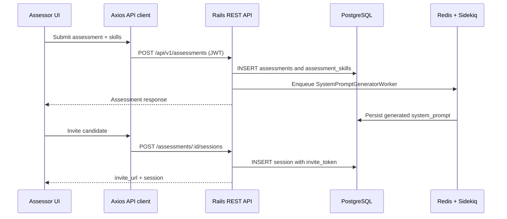
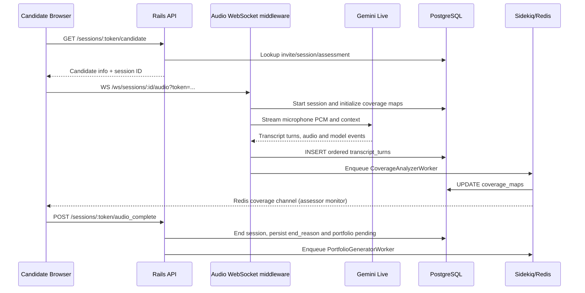

# Phase 1 — Architecture Discovery & Executable Baseline

> Assessment working copy. **Evidence status:** `VERIFIED_SOURCE` means the named code/config was inspected; `VERIFIED_COMMAND` means the command was executed here; `NOT_EXECUTED` means there is no runtime confirmation; `REQUIRES_VALIDATION` is a hypothesis or integration contract to test in Phase 2.  
> **Scope:** Phase 1 only, 22 October 2026 (Asia/Jakarta). No product implementation, test, CI, PR, or release changes. Company/product identifiers in upstream code are not reproduced here for publication.

## 1. Executive summary and baseline verdict

This is a two-service monorepo for configuring assessments, inviting interview candidates, running a real-time AI voice interview, tracking skill coverage and transcripts, creating structured portfolios, comparing portfolios with job vacancies, and exporting results. It has two distinct interfaces: an authenticated assessor dashboard and an invite-token candidate journey.

- **Source architecture mapped:** YES (`VERIFIED_SOURCE`, paths cited below).
- **Backend executable baseline:** **BLOCKED**, not proven broken. Boot command fails in the current isolated environment with `Bundler::RubyVersionMismatch`: installed Ruby 3.3.8, declared Ruby 3.3.2; Rails gem absent, PostgreSQL and Redis not running.
- **Frontend executable baseline:** **BLOCKED**, not proven broken. `npm run build` fails because node modules are not installed (`vite/client` cannot be found); package manager cache and repo lack a dependency lockfile.
- **Cross-service smoke/data-persistence test:** **NOT_EXECUTED**. Neither service is running. HTTP probes returned connection refused; no sample or production data was touched.
- **Static parsing baseline:** all **78 `.rb` files** pass `ruby -c` under the available Ruby 3.3.8. That does not establish correct Rails behavior.
- **Current automated coverage:** no tracked `spec/`, `test/`, browser-test suite, or `.github/workflows` in the 188-file original source inventory. Gemfile declares RSpec test dependencies, but no test implementation was found. `web/package.json` has `dev`, `build`, `preview`, without a test/lint script.
- **Quality/release recommendation:** current baseline does **not** justify a `ship` decision. No runtime verification, cross-service evidence, or CI exists in this snapshot. This is a Phase 1 evidence limitation, **not** yet a classified P0/P1 product defect.

## 2. Scope, provenance and environment

- Source: user-supplied archive containing `api/` and `web/`; original file manifest `assessment/PHASE_0_FILE_INVENTORY.json`.
- Rechecked on Phase 1: all **188** original paths exist and their SHA-256 hashes match the Phase 0 manifest (**0 source changes, 0 missing**).
- Original upstream branch from previous intake: `main`; source Git tree was recorded during Phase 0; no independent local `.git` initialized. GitHub public repository creation is **expressly deferred by the user**.
- Installed tools: Ruby 3.3.8, Node 22.16.0, npm 10.9.2, global TypeScript 5.8.3, Git 2.47.3. **Declared backend Ruby: 3.3.2.**
- Missing environment resources: Rails gem/dependency bundle, backend `config/application.yml`, frontend `.env`, `web/node_modules`, `web/package-lock.json`, `psql`, `redis-server`, Docker runtime. No test PostgreSQL schema or disposable database provisioned.
- External service: Google Gemini HTTP and Live API; no credentials configured, live network/model behavior **NOT_TESTED**.
- DO NOT seed/connect to a shared database or insert real candidate information without an isolated, disposable test environment. Do not generate/store live interview secrets in the repository.

### Documented startup recipe (instructions, **not successfully executed**)

The working source's root README says start API and then the web client; the API README describes Ruby 3.3.2, PostgreSQL, Redis, Sidekiq, Figaro environment config, seed data, and port 3001. The web README describes Node 18+, npm, and port 5173.

```bash
# From repository root, once prerequisites are provisioned:
cd api
cp config/application.yml.sample config/application.yml
# Edit only LOCAL values: SECRET_KEY_BASE, database, REDIS_URL, ALLOWED_ORIGINS, Gemini credentials.
bundle install
bundle exec rails db:create db:migrate db:seed  # isolated test/local DB ONLY
# In another terminal: start Redis, then Sidekiq (refer to api/README.md).
bundle exec sidekiq -r ./config/environment.rb -C config/sidekiq.yml
# In another terminal:
bundle exec rails server

# Separate terminal from repository root:
cd web
cp .env.example .env
# Set VITE_API_BASE_URL=http://localhost:3001/api/v1
# Set VITE_WS_BASE_URL=ws://localhost:3001
npm install
npm run dev
```

**Documentation drift to resolve before a reproducible run:** the API README's last step references `../ai-interview-web`, but this monorepo directory is `../web`; the web README prose and the checked-in `.env.example` default to backend port 3000, whereas the root README, API README and `api/config/puma.rb` indicate port 3001. Treat these as documented setup inconsistencies, not verified application defects. The web README expects a dev JWT and test tenant variables; use **locally generated non-production** values only.

## 3. Architecture: runtime components and trust boundaries

| Component | Verified implementation / responsibility | Evidence |
|---|---|---|
| Assessor React application | Protected layouts, assessment and vacancy forms, interview monitor, portfolio, transcript and fit/gap views | `web/src/App.tsx`; `web/src/pages/**` |
| Candidate React application | Public `/interview/:token` route; hardware check, microphone capture, audio playback, interview state | `web/src/pages/interview/InterviewPage.tsx`; `web/src/components/HardwareCheck.tsx` |
| REST client | Axios instance; Bearer token from client storage; API base URL from `VITE_API_BASE_URL`; 401/403 handling | `web/src/services/api.ts` |
| Frontend state | Jotai auth/tenant atoms, React local component state and effects | `web/src/stores/*`, `web/src/pages/**` |
| Audio WebSocket | Rack/Faye WebSocket proxy to Gemini Live; buffer/reconnect; session lifecycle, transcription, coverage scheduling | `api/app/channels/audio_websocket_middleware.rb` |
| Coverage WebSocket | Assessor live view; initial snapshot, Redis Pub/Sub update stream | `api/app/channels/coverage_websocket_middleware.rb` |
| Rails API | CRUD/auth/candidate/session/portfolio/report endpoints | `api/config/routes.rb`, `api/app/controllers/api/v1/*` |
| Request scoping | Tenant resolved from JWT/header/referer; role auth via signed JWT; `TenantScoped` ActiveRecord default scope | `api/app/middlewares/tenant_resolver_middleware.rb`, `api/app/auth/authorize_api_request.rb`, `api/app/models/concerns/tenant_scoped.rb` |
| Persistence | PostgreSQL tables with `ai_interview,public` search path, foreign keys, constraints, JSONB, enums | `api/config/database.yml`, `api/db/schema.rb` |
| Async processing | Sidekiq workers for prompt generation, coverage analysis, portfolio generation and fit/gap | `api/app/workers/*`, `api/config/sidekiq.yml` |
| External AI | Gemini HTTP for assessment/coverage/portfolio/fit-gap processing; Gemini Live bidirectional audio | `api/app/clients/gemini/*`, `api/app/services/*` |
| Cache/events | Redis for queue storage, throttling and session coverage updates | `api/config/initializers/sidekiq.rb`, `rack_attack.rb`, session handlers and WS middleware |
| Deployment config | Backend Dockerfile and Kubernetes manifests; Vercel frontend config | `api/Dockerfile`, `api/k8s/*`, `web/vercel.json` |

### Trust boundaries to test, without presuming a defect

1. **Untrusted browser → REST:** credentials in `Authorization` header; assessor routes call `authorize_auth_token! :assessor`; role and tenancy need to be verified across reads and writes, not inferred from React route guards.
2. **Invite URL → candidate APIs/WS:** candidate REST paths skip assessor JWT checks and resolve by invite token; audio WebSocket also accepts token query parameter. Confirm token-to-session correspondence, tenant isolation, expired/ended semantics, and access control.
3. **REST/API → PostgreSQL:** `assessments`, `sessions`, `vacancies` include `TenantScoped`; related records rely on joins/associations and contextual scoping. Check query boundaries and tenant consistency in Phase 2.
4. **Background jobs → database:** Sidekiq runs outside an HTTP request. Determine how tenant context is established and maintained for job reads/writes; don't assume request-based default scopes work in workers.
5. **Candidate audio/transcript → external model:** third-party data handling, exception paths, retries, persistence, transcript/portfolio evidence. No live Gemini calls performed.
6. **Redis events → browser:** real-time messages and HTTP reads must agree after reconnects; event loss alone must not corrupt authoritative database state.

## 4. Backend API inventory (defined routes, not verified responses)

`api/config/routes.rb` provides these route families. RESTful `resources` expands to the usual Rails CRUD routes; actual routing has not been inspected via `rails routes` because boot is blocked.

| Method and path (`/api/v1` prefix unless noted) | Controller / handler | Intended access and side effect |
|---|---|---|
| `POST /auth/login` | `authentication#authenticate` | Email/password, admin account; returns JWT; skips tenant prerequisite |
| `GET /health`, `GET /health` (root outside prefix) | Rack route proc | Lightweight health response; not tested |
| `POST /speed_test` | Rack route proc | Discards uploaded payload, returns declared length |
| `GET /assessments`, `GET /assessments/:id` | `assessments#index/show` | Auth assessor; read assessments/skills |
| `POST /assessments`, `PATCH/PUT /assessments/:id` | `assessments#create/update` | Auth assessor; persistence, queue prompt-generation worker |
| `DELETE /assessments/:id` | `assessments#destroy` | Auth assessor; deletion controlled by model associations |
| `GET /assessments/:assessment_id/sessions` | `sessions#index` | Auth assessor; list interview sessions |
| `POST /assessments/:assessment_id/sessions` | `sessions#create` | Auth assessor; persist session/invite token and return invite URL |
| `GET /sessions/:id` | `sessions#show` | Auth assessor; session data |
| `POST /sessions/:id/end_session` | `sessions#end_session` | Auth assessor; end session via handler, enqueue portfolio |
| `GET /sessions/:id/coverage`, `GET /sessions/:id/transcript` | `sessions#coverage/transcript` | Auth assessor; read persisted coverage/transcript |
| `GET /sessions/:id/portfolio` | `portfolios#show` | Auth assessor; read portfolio or generating status |
| `POST /sessions/:id/portfolio/regenerate` | `portfolios#regenerate` | Auth assessor; requeue failed portfolio |
| `GET /sessions/:token/candidate` | `sessions#candidate_info` | Invite-token candidate; read public session info |
| `POST /sessions/:token/audio_complete` | `sessions#audio_complete` | Invite-token candidate; triggers end handler |
| `POST /portfolio_skills/:id/override` | `portfolio_skills#override` | Auth assessor; persist override and regenerate prior reports |
| `GET /skill_taxonomies`, `GET /skill_taxonomies/:skill_id` | `skill_taxonomies#index/show` | Auth assessor; read reference taxonomy |
| `GET/POST /vacancies`, `GET/PATCH/PUT/DELETE /vacancies/:id` | `vacancies` actions | Auth assessor; CRUD expected skills and vacancy metadata |
| `POST /portfolios/:id/fitgap` | `portfolios#fitgap` | Auth assessor; read cached report or queue generation |
| `POST /portfolios/:id/regenerate_fitgap` | `portfolios#regenerate_fitgap` | Auth assessor; invalidate and queue new report |
| `GET /portfolios/:id/fitgap/:vacancy_id` | `portfolios#show_fitgap` | Auth assessor; read persisted report |
| `GET /portfolios/:id/export` | `portfolios#export` | Auth assessor; return JSON or PDF |
| `WS /ws/sessions/:id/audio` | `AudioWebSocketMiddleware` | Candidate invite/JWT; audio transcription, session control and Gemini Live |
| `WS /ws/sessions/:id/coverage` | `CoverageWebSocketMiddleware` | Assessor session monitor, Redis event subscription |

**Request/response envelopes:** `Response#json_response` renders its argument directly, whereas `web/src/services/api.ts` unwraps a `data` envelope if present. Some endpoints return `202` with raw `{status: 'generating'}` while others use nested named payloads. Include asynchronous response and error-shape coverage in Phase 2.

## 5. Frontend screens and API clients

| Route | Page / flow | Frontend service |
|---|---|---|
| `/login` | `LoginPage`: admin login | `authApi.login` |
| `/assessments` | `AssessmentListPage`: assessment list | `assessmentsApi.list` |
| `/assessments/new`, `/:id/edit` | Assessment form; skill anchors, order, time, language | `assessmentsApi.create/update` |
| `/assessments/:id/invite` | List/create session and invite candidate | `assessmentsApi.getSessions/createSession` |
| `/assessments/:id/sessions/:sessionId/monitor` | Live monitor, transcript, end session | `sessionsApi.get/getTranscript/endSession`, coverage WS |
| `/assessments/:id/sessions/:sessionId/transcript` | Full transcript | `sessionsApi.getTranscript/get` |
| `/assessments/:id/sessions/:sessionId/portfolio` | Generated skills, override and export | `sessionsApi.getPortfolio`, `portfoliosApi.getOverride/exportPortfolio` |
| `/assessments/:id/sessions/:sessionId/fitgap/:vacancyId` | Comparative report, generation/retry/export | `portfoliosApi.getFitGap/triggerFitGap/regenerateFitGap` |
| `/vacancies`, `/new`, `/:id/edit` | Vacancy list and expected competency configuration | `vacanciesApi.list/create/update` |
| `/interview/:token` | Candidate invite view, hardware/audio/connectivity | `sessionsApi.getCandidateInfo/audioComplete`, audio WS |

**State/error handling inspected:** React component state for loading and server errors in login/assessment forms; localStorage token and Jotai auth atom; `ProtectedRoute` checks token existence client-side; the Axios interceptor clears local token on 401/403. No TanStack Query/SWR or dedicated client cache library was found in `package.json`; forms use React Hook Form, and Zod is installed but actual per-form validators must be checked individually. The interview uses reconnection/state callbacks and audio worklet; this is timing-sensitive.

**Client contract targets for Phase 2:** ensure all `web/src/services/*` calls map to backend routes, HTTP `202` states are handled as pending rather than success-with-data, error envelope matches UX, export formats are correct, and persisted entity values round-trip into edit/details views. `authApi.signup` exists but no `POST /signup` is declared in `api/config/routes.rb`; it appears to be called from a `SignupPage` not routed in `web/src/App.tsx`. Determine whether the signup flow is in or out of scope before classifying it as a defect.

## 6. Persistence model, ownership and invariants

The checked-in `api/db/schema.rb` defines **14 tables** (11 domain/config tables plus three related skill/catalog or user tables; see exact list below), PostgreSQL enums, foreign keys, check constraints, and JSONB. Treat `schema.rb` as declared schema, **not proof of deployed schema state**.

| Entity / table | Main relations or important data | Required consistency |
|---|---|---|
| `organizations` | Identifies tenant by scheme/host; public schema | Tenant resolves to intended organization |
| `users` | Email, password digest, role | Auth role and ownership semantics |
| `assessments` | `tenant_id`, `created_by`, name, duration, language, system prompt | Tenant and configuration saved as submitted |
| `assessment_skills` | Assessment FK, 5 anchors, expected level, display order | Accurate skill set/order; non-null anchors |
| `sessions` | Tenant/assessment FK, invite token, status, time/duration, candidate data | Session lifecycle transitions and one invite identity |
| `transcript_turns` | Session FK, ordered AI/candidate turns | Order and exactly-once/idempotent turn persistence |
| `coverage_maps` | Session FK, configured/discovered skills, state/probe count | Consistent coverage states and UI/DB agreement |
| `portfolios` | One per session, generation status/error | Async generation state remains coherent |
| `portfolio_skills` | Portfolio FK, AI level/confidence/evidence | Persisted evidence and scored level agree |
| `assessor_overrides` | Unique portfolio skill FK, override level, reviewer/time | Exactly one effective override per skill |
| `vacancies` | Tenant FK, role title, culture, expectations | Vacancy belongs to appropriate tenant |
| `vacancy_skills` | Vacancy FK, required level | Every comparison uses the correct expected level |
| `fit_gap_reports` | Portfolio-vacancy unique pair, JSONB comparisons, narrative | Cached report reflects latest effective scores and vacancy |
| `skill_taxonomies` | Global reference skill, anchors and category | Reference skill ID/labels resolved consistently |

Schema safeguards: unique index on `sessions.invite_token`, `portfolios.session_id`, `assessor_overrides.portfolio_skill_id`, `(fit_gap_reports.portfolio_id, vacancy_id)`, `(coverage_maps.session_id, skill_label)`, `(transcript_turns.session_id, turn_number)`; check constraints for L1–L5 and assessment duration. The DB search path is `ai_interview,public`, with `organizations` documented as shared/public.

**Boundary requiring extra verification:** only `Assessment`, `Session` and `Vacancy` directly include `TenantScoped`; several domain children scope indirectly through parent records. Sidekiq worker request context and unscoped lookups warrant explicit isolated-tenant tests. No assertion of a tenant data leak is made here.

## 7. Core end-to-end data flows (source-derived, not runtime-confirmed)

### A. Assessor creates assessment and candidate invite



**Primary artifacts:** `Assessment`, `AssessmentSkill`, `Session`, `SystemPromptGeneratorWorker`. **Verification needed:** DB matches form data after save and re-fetch; prompt worker success is not equated to merely being enqueued; invite URL points to actual public frontend base URL.

### B. Candidate live interview, transcript, coverage and lifecycle



**Authoritative state:** DB `sessions`, `transcript_turns`, `coverage_maps`, `portfolios`; redis and browser state are async presentations. **Verification needed:** reconnect/idempotency, token authorization, partial cover states, final transcript completeness, and one-time state transitions.

### C. Portfolio generation → assessor override → vacancy fit/gap → export

```mermaid
sequenceDiagram
    participant U as Assessor UI
    participant API as Rails API
    participant Q as Sidekiq
    participant AI as Gemini HTTP
    participant DB as PostgreSQL
    Q->>AI: Generate portfolio from transcript + coverage
    AI-->>Q: Scored skills and evidence
    Q->>DB: SAVE portfolio_skills; mark portfolio complete
    U->>API: GET session portfolio
    API->>DB: READ portfolio and scores
    API-->>U: Portfolio JSON
    U->>API: POST portfolio_skills/:id/override
    API->>DB: SAVE override; invalidate prior fit/gap reports
    API->>Q: Enqueue new fit/gap generation
    Q->>DB: READ vacancy skills and effective scores
    Q->>AI: Narrative generation
    Q->>DB: UPSERT fit_gap_reports
    U->>API: GET /portfolios/:id/fitgap/:vacancy_id or /export
    API->>DB: READ report
    API-->>U: JSON/PDF response
```

**Data integrity checkpoints:** score from AI vs approved override, comparison delta/result, report cache invalidation on override, export parity with stored report.

## 8. Phase 1 checks: reproducible evidence (command output preserved)

Executed commands and their **actual** statuses are recorded in `assessment/evidence/phase-1/*.log`:

| Command | Exit | Result and interpretation |
|---|---:|---|
| `ruby --version; node --version; npm --version; ...` | 0 | Toolchain versions recorded in `versions.log` |
| `ruby bin/rails --version` (`api/`) | 1 | `Bundler::RubyVersionMismatch`: installed 3.3.8, Gemfile 3.3.2 |
| `ruby -e 'require "rails"; puts Rails.version'` | 1 | `LoadError`: Rails gem not installed |
| `find . -name '*.rb' ... ruby -c` (`api/`) | 0 | 78 Ruby files reported `Syntax OK` |
| `tsc --noEmit --project tsconfig.json` (`web/`) | 2 | TS2688: `vite/client` type definitions unavailable (deps absent) |
| `npm run build` (`web/`) | 2 | Same `vite/client` missing dependency; no Vite bundle built |
| `npm run` (`web/`) | 0 | Only `dev`, `build`, `preview` scripts exist |
| `node --check postcss.config.js`, `tailwind.config.js` | 0 | JavaScript config syntax passed |
| `curl http://127.0.0.1:3001/health` | 7 | Connection refused: API not running |
| `curl http://127.0.0.1:5173/` | 7 | Connection refused: web not running |

Do not count Ruby syntax checks as unit/integration tests. Do not report successful frontend build, Rails boot, DB migration, API response, screenshot-based UX test, end-to-end flow, CI run, or data-write round trip. **No such execution occurred.**

### What a truthful executable baseline requires next

1. Provision Ruby **3.3.2** with compatible Bundler plus database/Redis tooling in a controlled environment.
2. Install locked API gems using `api/Gemfile.lock`; inspect any version/platform resolution mismatch before changing any dependency.
3. Supply local-only `api/config/application.yml`, isolated DB, and fake/non-production account/token. Configure tenant/organization data and safe seeds.
4. Install frontend dependencies; **note absence of web lockfile** and capture resolution versions. Do not imply deterministic `npm ci` is possible before a lockfile is generated and reviewed.
5. Run `bundle exec rails db:migrate` only against disposable DB; boot Rails, Sidekiq and Vite and verify health endpoints.
6. Execute a minimal isolated write/read: create assessment -> read back; create session -> candidate info; verify DB records and linked tenant IDs; do not use real candidate personal data.
7. For external AI and audio, use reviewed deterministic stubs/mocks where practical. A real Gemini invocation is neither available nor necessary for first local smoke check.
8. Repeat typecheck/build and collect evidence; only then classify failures as product defects rather than environment-blocked checks.

## 9. Risk-ranked **audit targets**, NOT confirmed defects

The next phase must pursue observations and reproducible tests rather than treating these as findings:

| Priority to investigate | Concern / observable test question | Evidence source | Evidence status |
|---|---|---|---|
| Highest | Unauthorized assessor/candidate from another tenant cannot read or mutate unrelated sessions/portfolios/fitgap, including WebSockets and workers | JWT/tenant middleware, `TenantScoped`, controllers and WS middleware | `REQUIRES_VALIDATION` |
| Highest | Session status, transcript and coverage persist correctly across start/reconnect/end; no duplicate/lost turns or side effects | `Sessions::*Handler`, audio middleware, coverage worker | `REQUIRES_VALIDATION` |
| Highest | Assessor override changes effective levels in new fit/gap report and export, with no stale cached results | overrides controller, `FitGap::Engine`, portfolio/export controller | `REQUIRES_VALIDATION` |
| High | Candidate invite token, expiry and replay semantics match an explicit specification | token routes and invite URLs | `SPEC_NEEDED` |
| High | Assessment/vacancy nested skills reflect UI-submitted order/values in DB and reopened views | frontend forms, strong params, models | `REQUIRES_VALIDATION` |
| High | Sidekiq retries/errors produce explicit generation statuses; HTTP `202`/poll handling does not display false success | workers, web portfolio/fitgap pages | `REQUIRES_VALIDATION` |
| Medium | Startup, auth/tenant test fixtures, required external providers and runtime versions are consistently documented | README/env/manifest | `VERIFIED_SOURCE` drift, behavioral effect not tested |
| Medium | Unused signup service/page is intentionally out of scope, not a missing supported feature | `authApi.signup`, `SignupPage`, route table | `SPEC_NEEDED` |
| Medium | Access control of browser-side token storage, websocket authentication and refresh UX matches the intended threat model | auth atom/ProtectedRoute/interceptors | `REQUIRES_VALIDATION` |

**Scope distinction:** missing/ambiguous business requirements must stay separate from confirmed implementation defects, especially for candidate invite expiration, signup availability, portfolio regeneration/override rules and multi-tenant authorization ownership.

## 10. Exit checklist and transfer to Phase 2

- [x] Both service READMEs and startup prerequisites reviewed.
- [x] API routes, auth, tenancy, models, schema, workers and external integrations mapped from source.
- [x] Frontend routes, state, forms, client contracts and WebSockets mapped from source.
- [x] Representative end-to-end data flows and persistence checkpoints documented.
- [x] Baseline static checks attempted with captured command output and exit codes.
- [x] Explicit runtime blockers documented; no false claims of successful boot.
- [ ] API + frontend boot simultaneously — **BLOCKED_BY_ENVIRONMENT**.
- [ ] DB write/read and full cross-service smoke — **BLOCKED_BY_ENVIRONMENT**.
- [ ] Build/typecheck with installed frontend dependencies — **BLOCKED_BY_ENVIRONMENT**.
- [ ] Product requirement/wiki review and live behavior comparison — **DEFERRED_TO_PHASE_2**.

**Phase 1 exit assessment:** `PASS_WITH_DOCUMENTED_RUNTIME_BLOCKERS` under the PLAN.md exit clause **“both services run OR concrete blockers are documented; core paths, persistence points, and current checks are understood.”** It does **not** mean executable baseline has passed. The next phase's audit must keep unsupported behavior claims unverified, and must not call the system releasable without real runs.

**Stop rule:** Do not start Phase 2, implement tests, commit code, build a release or create a remote repository without a new user instruction. Independent GitHub repo creation remains **deferred by the user**.
